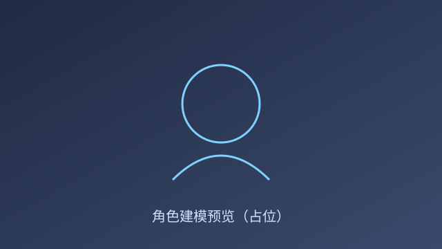
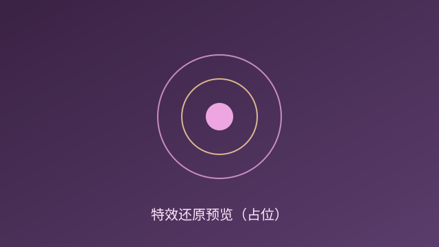
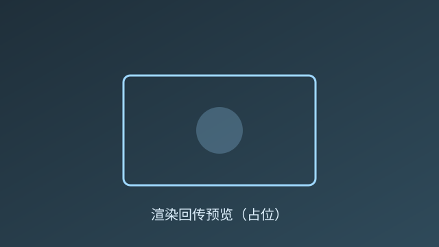

# DSH Blender Bridge

> 原生 DSH 插件 × 独立 Blender Addon，基于本地 WebSocket 长连接的双向实时桥接，
> 打造「多模态输入 → AI 解析 → 3D 生产 → 迭代优化 → 渲染交付」全闭环工作流。

[](LICENSE)
[](#)
[](CHANGELOG.md)

---

## 1.1.8 修复版（当前版本，2026-11-19）

在 Blender **5.3.0** 真机上完成完整审计与修复，逐条证据见 [AUDIT.md](AUDIT.md)。

**两个致命 bug（不修则插件在 Blender 5.x 上加载即报错）**

- `addon_state.py`：模块内 `get_logger` 同名定义遮蔽导入 → `TypeError: get_logger() got an unexpected keyword argument 'level'`。
- `__init__.py`：`register()` 阶段访问 `bpy.data.scenes`（此时是 `_RestrictData`）→ 启用即崩，改为延迟一次的场景同步。

**11 项健壮性 / 安全问题**

| 编号 | 问题 | 修复 |
| --- | --- | --- |
| V1 | 闲置 TCP 连接可永久占满桥接（本地 DoS） | 握手超时 `handshake_timeout`，未握手连接超限直接 503 |
| V2 | 并发上限 off-by-one | 只统计已握手连接，配置值即实际可用数 |
| V4 | 不校验客户端帧掩码 | 未掩码帧回 close `1002` |
| V5 | 单帧 / 分片无上限 | 超 `max_message_size_mb` 回 `1009` |
| V6 | 400 响应状态行写死 `Forbidden` | 状态码短语表，`400 Bad Request` / `503 Service Unavailable` |
| V7 | 心跳 PING 每秒重复 | `last_ping_sent` 去重，未握手连接不参与心跳 |
| V8 | 口令非常量时间比较 | `hmac.compare_digest` |
| V9 | 配置写在插件安装目录，升级即丢 | 迁到 `%APPDATA%\DSH_Bridge\config`，旧配置自动迁移、原子写 |
| V10 | 传输层：空 md5 跳过校验、resume 语义错乱、base64 未校验 | md5 必填、续传仅在 size/chunk/md5 一致时生效、`b64decode(validate=True)` |
| V11 | 队列无上限、丢弃不回包 | `E_BUSY`（队满）/ `E_TIMEOUT`（排队超时） |
| V12 | 参数错误一律 `E_EXEC` + Blender C API `SystemError` | 新增 `utils/errors.py`，统一 `E_PARAM` 中文提示 |
| V13 | **DSH 桌面应用 Origin `dsh-app://app` 被 403** → 状态胶囊永远灰 | 白名单支持完整 Origin + 默认放行 + 旧配置自动迁移 |

**回归数据（113 条指令，Blender 5.3 真机）**

- 空 payload：修复前 25 成功 / 88 失败（含 1 条 `E_EXEC`）→ 修复后 **28 / 85 / 0 E_EXEC / 0 崩溃**
- 错误类型 payload fuzz（两轮 226 条）：修复前约 70 条 `SystemError` → 修复后 **0 E_EXEC**
- 协议 7/7、传输 10/10、纯 Python 回归 **39/39**、真实工作流冒烟 13 成功 / 7 预期失败
- DSH 端到端：`blender_status` 返回 `running:true, addon_version:1.1.8, command_count:113`

> 旧版 `src/dsh_plugin/` 使用自创 `manifest.json` 格式并依赖不存在的 `window.DSH` 宿主 API，**无法被 DSH 插件管理器加载**。
> 1.1.8 起提供可用的原生 bundle [src/dsh_bundle/](src/dsh_bundle/)（3 个工具 + 状态胶囊）；`src/dsh_plugin/` 保留作历史参考，不再维护。

---

## 核心特性

- **双向实时桥接**：本地 WebSocket 长连接，30s 心跳检测、断线指数退避自动重连、连接状态实时可视化。
- **标准化协议**：6 字段 JSON 信封（指令 ID / 类型 / 参数体 / 状态 / 结果 / 错误），批量指令队列串行 / 并行执行。
- **多模态分片传输**：图片 / 视频断点续传 + MD5 校验，大文件稳定无损坏；成品图 / 视频反向回传预览。
- **图片驱动建模**：单 / 多图解析，三档面数精度，50+ 面部形状键、服装 / 发型分层、UV 展开、基础 PBR 烘焙、标准人形骨骼自动绑定。
- **视频驱动动画与特效**：21+ 关节轨迹复刻、帧率匹配降噪；粒子 / 辉光 / 流体 / 形变 / 镜头运动映射为可编辑节点。
- **自然语言建模**：中文提示词解析为 35 种建模指令、17 种动画指令、10 种材质指令。
- **第三方插件生态**：识别已启用 Blender Addon，按能力归类、发现算子，自然语言匹配并安全调用；内置 20 个常用插件目录映射，支持运行时启停、全局算子检索、批量套用与几何节点组挂载。
- **材质渲染闭环**：PBR 节点树生成、批量材质管理、预设存取、Eevee / Cycles 切换、成品自动回传。
- **反向迭代**：模型 / 动画 / 材质 / 场景一键回传 DSH，支持多轮 AI 优化。
- **工程化与稳定性**：分级日志、指令校验、场景备份回滚、分批内存管理、闲置缓存释放、全链路异常兜底。

## 效果预览

> 截图占位：接入真实素材后替换 `assets/` 下图片。

| 角色建模 | 动捕复刻 | 特效还原 | 渲染回传 |
|---|---|---|---|
|  |  |  |  |

## 仓库导航

```
dsh-blender-H/
├── src/
│   ├── dsh_bundle/            # ✅ 原生 DSH 插件包（package.json + cordis.patch.yml + 3 个工具 + 状态胶囊）
│   ├── dsh_plugin/            # ⚠️ 旧版自创格式前端，无法被 DSH 加载，仅作历史参考
│   └── blender_addon/         # Blender Addon（Python，4.2 LTS ~ 5.3）
│       ├── core/              # 协议 / WebSocket 服务 / 分片传输 / 分发器 / 队列 / 桥接主控
│       ├── ai/                # AI 解析适配层（抽象 / Mock / HTTP / 注册降级）
│       ├── handlers/          # 建模 / 角色 / 动画 / 特效 / 材质 / 渲染 / 场景 / 导出 / 流水线
│       ├── compat/            # 版本兼容层
│       ├── config/            # 默认配置与运行时配置迁移
│       ├── utils/             # 日志 / 备份 / 路径 / 参数校验（errors.py）
│       ├── operators.py       # 操作符与属性组
│       └── panel.py           # 侧边栏面板
├── docs/
│   ├── INSTALL.md             # 安装部署手册
│   ├── USAGE.md               # 使用说明书（34 条示例提示词）
│   ├── API.md                 # 通信协议 / 指令集 / 数据格式 / 扩展指南
│   └── ARCHITECTURE.md        # 架构设计文档
├── examples/
│   ├── case1_character_from_image/   # 单图角色 + 绑定全流程
│   ├── case2_mocap_effects/          # 行走动画 + 光效粒子复刻
│   ├── case3_roundtrip_iteration/    # 回传二次迭代全流程
│   └── case4_xianxia_fight/          # 仙侠打斗：姿态/跟随/能量特效/镜头震动
├── scripts/                   # 一键打包脚本（sh / ps1）
├── tests/                     # 协议 / 传输层单元测试（标准库）
├── assets/                    # 图标与预览资源
├── README.md / LICENSE / CHANGELOG.md / AUDIT.md / .gitignore
```

## 快速开始（三步）

```bash
git clone https://github.com/hhc2939526265-sudo/dsh-blender-H.git
```

1. **安装 Blender Addon**：Release 下载 `DSH_Blender_Bridge_Addon_v1.1.8.zip` →
   Blender 偏好设置 → 插件 → 从磁盘安装 → 勾选启用 → 侧边栏 `DSH Bridge` 启动服务。
2. **安装 DSH 插件**：把仓库里的 [src/dsh_bundle/](src/dsh_bundle/) 以「本地安装」指向该目录
   （`plugin_manager(action: "install_bundle", target: "<src/dsh_bundle 绝对路径>")`），刷新页面。
3. **连接使用**：在 Blender 侧边栏 `DSH Bridge` 点「启动服务」，输入框左侧的胶囊变绿即连通 →
   对话里让模型 `blender_exec` 建模 / 材质 / 渲染 / 导出。

> 1.1.8 起 DSH 端不再需要「面板 iframe」，三个工具直接在对话里调用，详见 [AUDIT.md](AUDIT.md)。
> 历史安装说明见 [docs/INSTALL.md](docs/INSTALL.md)（其中 Release 文件名与 `dsh_plugin` 部分对应 1.1.7）。

## 本地开发与打包

```bash
# 运行单元测试（无需 Blender）
python3 -m unittest discover -s tests -v

# 一键打包（Linux / macOS）
bash scripts/package_all.sh

# Windows PowerShell
powershell -ExecutionPolicy Bypass -File scripts/package_all.ps1
```

产物输出到 `packages/`：Addon 安装包、DSH 插件包、完整源码包。

## 指令规模

- 建模指令 35 种｜动画指令 17 种｜材质指令 10 种｜特效指令 18 种｜插件生态指令 11 种
- 角色 / 渲染 / 场景 / 导出 / 流水线 / 自然语言指令若干，完整清单见 [docs/API.md](docs/API.md)

## 已知限制

- **真机覆盖范围**：1.1.8 已在 Blender **5.3.0**（Windows）真机跑通 113 条指令、协议 / 传输用例与四个渲染导出链路；4.2 LTS ~ 5.2 仅由 `compat/` 层静态兜底，未逐一真机验证。
- **执行超时不可中断**：指令在 Blender 主线程顺序落地，主线程不可抢占；`command_timeout` 仅控制排队等待时长，正在执行的指令无法中途取消。
- **AI 为可插拔抽象**：默认 Mock 离线兜底；真实人物重建 / 动作复刻 / 特效还原度取决于接入的外部推理服务。
- **默认无口令**：桥接默认只监听回环且无 `auth_token`，本机任意 `localhost` 页面可驱动 Blender；对不受信环境请设口令（见 [AUDIT.md](AUDIT.md) 第 6 节）。

## FAQ

**Q：不接外部 AI 服务能用吗？**
A：可以。默认内置本地规则兜底（Mock），可离线跑通全流程演示；接入真实后端只需在配置中切换 `ai.provider`。

**Q：支持哪些 Blender 版本？**
A：4.2 LTS ~ 5.3，版本差异由 `compat/` 层隔离，低版本不支持的功能自动降级。

**Q：需要手动 pip 安装依赖吗？**
A：不需要。Blender 端仅用内置 Python 库与标准库；DSH 端无第三方前端依赖。

**Q：端口被占用怎么办？**
A：两端面板同步修改端口后重启 / 重连即可，范围 1024 ~ 65535。

更多排查见 [docs/INSTALL.md](docs/INSTALL.md#五常见环境问题排查)。

## 贡献指南

欢迎提交 Issue 与 Pull Request。提交信息遵循 [Conventional Commits](https://www.conventionalcommits.org/zh-hans/)：

- `feat:` 新功能　`fix:` 缺陷修复　`docs:` 文档　`refactor:` 重构
- `perf:` 性能　`test:` 测试　`chore:` 工程化

开发规范与扩展方式见 [docs/API.md](docs/API.md#六二次扩展开发) 与 [docs/ARCHITECTURE.md](docs/ARCHITECTURE.md)。

## 开源协议

[MIT](LICENSE) © DSH-Blender Bridge Contributors
